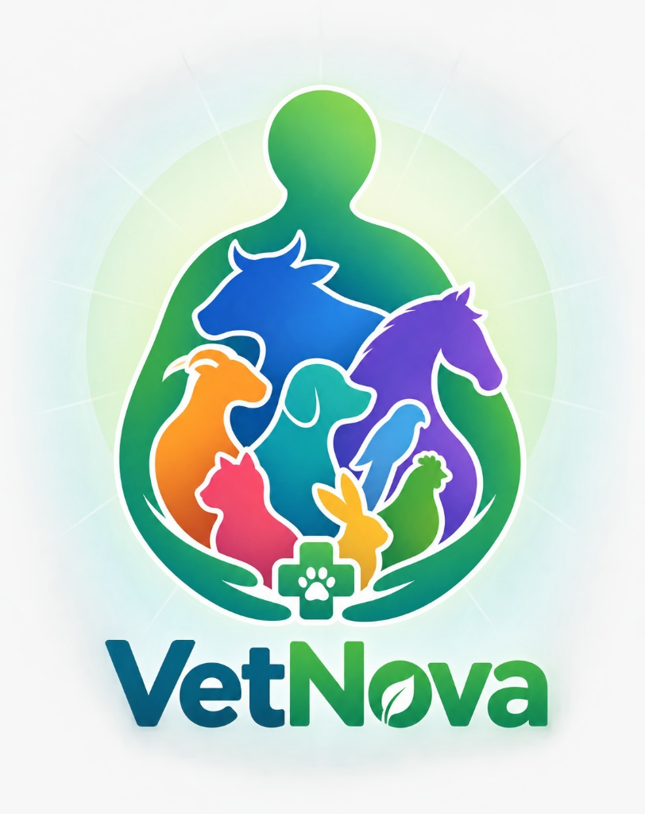
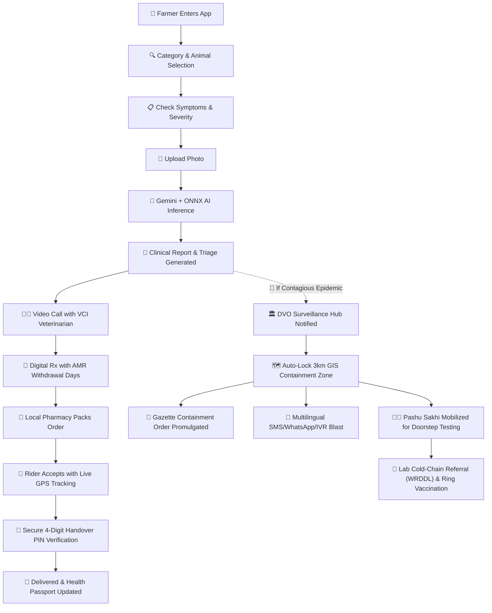

# 🐾 VetNova — Care for Every Life
### *AI-Powered Animal Healthcare, Telemedicine, Hyperlocal Veterinary Pharmacy & National Disease Surveillance Hub*

<p align="center">
  
</p>

<p align="center">
  <a href="#-about-vetnova"></a>
  <a href="#-sih-2026-alignment"></a>
  <a href="#-tech-stack"></a>
  <a href="#-supported-languages"></a>
  <a href="#-license"></a>
</p>

---

## 📖 Table of Contents
- [🌟 About VetNova](#-about-vetnova)
- [🇮🇳 SIH 2026 Problem Statement (PS ID: 26128)](#-sih-2026-problem-statement-ps-id-26128)
- [👥 6-Stakeholder Ecosystem](#-6-stakeholder-ecosystem)
- [🧠 Multi-Tier AI & ML Diagnostic Engine](#-multi-tier-ai--ml-diagnostic-engine)
- [🚀 Frontier Winning Innovations](#-frontier-winning-innovations)
- [🔄 End-to-End System Workflow](#-end-to-end-system-workflow)
- [🛠️ Tech Stack & Architecture](#-tech-stack--architecture)
- [📡 API Subsystems Reference](#-api-subsystems-reference)
- [💻 Getting Started & Installation](#-getting-started--installation)
- [🧪 Running Verification & Test Suites](#-running-verification--test-suites)
- [🌐 Supported Languages](#-supported-languages)
- [🛡️ Anti-Microbial Resistance (AMR) Safeguards](#-anti-microbial-resistance-amr-safeguards)

---

## 🌟 About VetNova

**VetNova** is an all-in-one veterinary digital health ecosystem that directly connects **Livestock Farmers & Pet Owners**, **Registered Veterinarians**, **Veterinary Pharmacies**, **Hyperlocal Delivery Riders**, **Field Para-Veterinarians (*Pashu Sakhis*)**, and **Government Animal Husbandry Authorities**.

### 🎯 Key Challenges Solved:
1. **Rural Veterinary Access Deficit:** Farmers in remote villages obtain instantaneous AI triage and connect with licensed veterinarians on low-latency video consultations.
2. **Preventing Outbreak Pandemics:** Paper-based disease notifications taking 7–14 days are replaced with real-time GPS alerts (<30 seconds).
3. **Emergency Medicine & Cold-Chain Supply:** Hyperlocal pharmacy dispatch with OTP security PINs and autonomous drone air-drops for flood-cut or mountainous regions.
4. **Food Safety & AMR Protection:** Tracks milk and meat drug withdrawal periods to eliminate harmful antibiotic residues from our human food supply chain.
5. **Anti-Fraud Livestock Identity:** Muzzle print biometrics (*Pashu Rhinoglyphics*) replace frequently swapped ear-tags.

---

## 🇮🇳 SIH 2026 Problem Statement (PS ID: 26128)
> **Domain:** *Animal Health Surveillance, Early Warning & Triage System (Dept. of Animal Husbandry & Dairying)*

VetNova provides a **zero-exclusion national surveillance pipeline**:
* 📍 **Automated 3 km Containment Rings:** Instant GIS perimeter locking with animal movement bans and emergency ring vaccination radius.
* 📈 **Epizootic Curve & $R_t$ Transmission Tracking:** Computes effective reproduction rates and correlates weather/monsoon data with insect vectors.
* 📞 **1962 Toll-Free Helpline Support:** IVR phone DTMF integration for non-smartphone livestock owners.
* 📶 **Offline Batch Sync for Field Workers:** Para-vets (*Pashu Sakhis*) screen herds in no-network tribal hamlets and sync when network is restored.
* 📜 **Automated Gazette Orders & Alerts:** Issues official DVO containment gazettes and multi-channel advisories (SMS, WhatsApp, Voice Calls) in English, Hindi, and Marathi.

---

## 👥 6-Stakeholder Ecosystem

```
                                  VETNOVA ECOSYSTEM
                                         │
        ┌──────────────┬─────────────────┼────────────────┬──────────────┬──────────────┐
        ▼              ▼                 ▼                ▼              ▼              ▼
   1. Farmer /     2. Doctor      3. E-Pharmacy     4. Delivery    5. Para-Vet    6. Government
   Pet Owner       (Vet B.V.Sc)     & Medical Store   Partner        (Pashu Sakhi)   (DVO / RRT)
```

<details>
<summary><b>Click to expand role descriptions</b></summary>

### 1. 🐄 Farmer & Pet Owner
- Multi-step visual triage wizard across **Dairy**, **Farm Ruminants**, **Pets**, and **Poultry**.
- Instant AI differential diagnoses with home remedies, first-aid, and biosecurity precautions.
- Video consultations with verified veterinarians with **50% discount for repeat visits within 30 days**.
- In-app pharmacy ordering with attached clinical report and live satellite GPS delivery tracking.
- Digital Animal Health Passport with permanent vaccination and treatment history.

### 2. 👨‍⚕️ Registered Veterinarian (Doctor)
- VCI (*Veterinary Council of India*) registration badge, degree certificate verification, and polyclinic profile.
- Customizable consultation fee, repeat follow-up fee, and direct UPI payment QR code.
- Teleconsultation console with real-time video, animal photo review, and digital prescription generator.
- Pharmacy dual-check verification: Doctors inspect packed medicine bundles before rider dispatch.

### 3. 🏪 Vet E-Pharmacy & Medical Store
- Real-time order console with full customer details and attached AI clinical diagnosis.
- One-click workflow from order intake $\to$ packaging $\to$ "Ready for Pickup".
- Full inventory and medicine catalog management.

### 4. 🛵 Hyperlocal Delivery Partner (Rider)
- Mobile OTP authentication, vehicle registration, and active delivery radar.
- Turn-by-turn route directions and continuous background GPS telemetry broadcaster.
- **Secure Handover PIN:** Handshake requires customer’s secret 4-digit PIN to prevent fake deliveries.
- Instant earnings ledger and instant UPI payout settlements.

### 5. 👩‍🌾 Para-Veterinary Worker / Pashu Sakhi
- Optimized for last-mile tribal/rural hamlets with **Offline Batch Sync Mode**.
- Doorstep herd inspection checklists and symptom logging.
- Biological diagnostic sample collection with cold-chain sensor assignment.

### 6. 🏛️ Government Animal Husbandry & DVO
- Executive command center displaying active outbreaks, ring vaccinations, and RRT team locations.
- Leaflet GIS centroid mapping, automated 3 km containment perimeters, and 10 km surveillance rings.
- Epizootic trend curves, effective $R_t$ rate, and rainfall/vector correlation analytics.
- One-click Gazette Containment Orders and multilingual broadcast alerts (SMS/WhatsApp/IVR).
</details>

---

## 🧠 Multi-Tier AI & ML Diagnostic Engine

```
                    INPUT: Animal Photo + Symptoms + Vitals + Species
                                           │
                                           ▼
                    ┌──────────────────────────────────────────────┐
                    │            IMAGE ANALYSIS ENGINE             │
                    └──────────────────────┬───────────────────────┘
                                           │
                  ┌────────────────────────┴────────────────────────┐
                  ▼                                                 ▼
       [ Tier 1: Cloud Vision ]                         [ Tier 2: Edge Neural Net ]
       Google Gemini 1.5 Pro                            ONNX Runtime / DNN v3.2
       Multimodal Clinical Reasoning                    Local 61-Disease Taxonomy
                  │                                                 │
                  └────────────────────────┬────────────────────────┘
                                           │
                                           ▼
                    ┌──────────────────────────────────────────────┐
                    │               CLINICAL FUSION                │
                    │  Differential Diagnoses + Confidence Score   │
                    │  Staged Treatment (Emergency, Acute, Maint.) │
                    │  AMR Safeguards & Mandatory MRL Withdrawal   │
                    └──────────────────────────────────────────────┘
```

* **Cloud Vision (Tier 1):** Gemini 1.5 Pro multimodal image analysis identifies cutaneous lesions, mucosal ulcers, hoof necrosis, and eye/nasal discharges.
* **Edge ONNX / DNN v3.2 (Tier 2):** Local offline multi-modal classifier running `animal_disease_model.onnx` covering **61 distinct livestock and pet diseases**.
* **Zero-Downtime Resilience:** If cloud APIs are throttled or internet is unavailable, the system automatically falls back to the local neural network in `< 1.8 seconds`.

---

## 🚀 Frontier Winning Innovations

### 1. 🎙️ BARDI AI (Bio-Acoustic Respiratory Disease Identification)
* **What it does:** Real-time audio frequency analysis of cattle chest/throat auscultations.
* **Extracted Biomarkers:** Parses peak frequencies (Hz), cough burst rate, wheezing intensity, and crackles.
* **Clinical Output:** Predicts respiratory pathogens (e.g., Bovine Respiratory Disease, *Mannheimia haemolytica*), severity scores, and first-line antibiotic regimens with withdrawal warnings.

### 2. 👃 Pashu Rhinoglyphics (Cattle Muzzle Biometrics)
* **What it does:** Anti-fraud bovine biometric identification based on immutable muzzle ridge prints.
* **Why it matters:** Solves the rampant problem of stolen, swapped, or torn RFID ear-tags in livestock insurance claims and vaccination records.
* **Technology:** Computer vision extracts epidermal ridge patterns and minutiae keypoints to compute a cryptographic biometric hash and fraud score.

### 3. 🚁 Autonomous Cold-Chain Drone Fleet (BVLOS Air-Drop)
* **What it does:** Deploys Beyond-Visual-Line-of-Sight (BVLOS) medical drones to deliver emergency vaccines and anti-venoms to inaccessible or flood-isolated hamlets.
* **Real-Time Telemetry:** Continuous monitoring of internal payload temperature (2°C–8°C), airspeed, altitude, and battery ETA.

---

## 🔄 End-to-End System Workflow



---

## 🛠️ Tech Stack & Architecture

| Component | Technology | Role |
| :--- | :--- | :--- |
| **Frontend** | React 18 (UMD via CDN), `@babel/standalone` | Dynamic component SPA without complex build steps |
| **Styling** | Vanilla CSS (`styles.css`, `styles-premium.css`) | Glassmorphism, mobile-responsive layout & micro-animations |
| **Mapping & GIS** | Leaflet.js 1.9.4 | Interactive maps, live GPS tracking, 3km containment circles |
| **Payment Gateway** | Razorpay SDK (`checkout.js`) | Digital appointment payments and UPI settlements |
| **Backend** | Node.js (ESM), Express 4.21 | High-throughput, concurrent API service (`server.js`) |
| **Machine Learning** | `onnxruntime-node`, `@google/generative-ai`, `sharp` | Dual-tier vision, edge ONNX inference & image preprocessing |
| **Email & Alerts** | `nodemailer`, `rss-parser` | Government email notices, real-time veterinary RSS news feeds |
| **Localization** | `public/locales.json` | Instant trilingual switching (**EN**, **HI**, **MR**) |

---

## 📡 API Subsystems Reference

<details>
<summary><b>Click to expand key API endpoints</b></summary>

### 🔐 Authentication & Accounts
* `POST /api/auth/send-otp` — Dispatch OTP to farmer mobile (test bypass: `123456`)
* `POST /api/auth/verify-otp` — Authenticate user session
* `POST /api/doctor/login` — Veterinarian portal authentication
* `POST /api/pharmacy/login` — Medical store authentication
* `POST /api/delivery/verify-otp` — Delivery partner onboarding

### 🩺 AI Diagnosis & Consultations
* `POST /api/analyze-image` — Multimodal vision diagnosis (Gemini 1.5)
* `POST /api/deep-neural-network/diagnose` — Local 61-disease DNN forward pass
* `POST /api/video-call/request` — Initiate video consultation
* `POST /api/video-call/:id/prescription` — Issue digital prescription with AMR days

### 💊 E-Pharmacy & Hyperlocal Delivery
* `POST /api/pharmacy/orders` — Order medicines with attached AI report
* `POST /api/pharmacy/orders/:id/status` — Pharmacist packaging progress
* `POST /api/delivery/orders/:id/location` — Broadcast live rider GPS coordinates
* `GET  /api/delivery/orders/:id/track` — Farmer satellite tracking with secret PIN

### 🏛️ SIH PS-26128 National Surveillance
* `POST /api/surveillance/report` — Log village symptom and mortality report
* `POST /api/surveillance/batch-sync` — Sync offline field reports from Pashu Sakhis
* `GET  /api/surveillance/geospatial-clusters` — Active clusters & 3km containment zones
* `POST /api/surveillance/containment-action` — Issue official Gazette Containment Order
* `POST /api/surveillance/broadcast-advisory` — Multilingual SMS/WhatsApp/IVR blast
* `POST /api/surveillance/ivr-report` — 1962 Toll-free voice phone report intake

### 🚀 Frontier Innovations
* `POST /api/surveillance/bioacoustic-analysis` — BARDI acoustic respiratory analysis
* `POST /api/surveillance/muzzle-biometrics` — Pashu Rhinoglyphics biometric hashing
* `POST /api/surveillance/drone-dispatch` — Autonomous cold-chain drone dispatch
* `GET  /api/surveillance/drone-missions` — Real-time drone fleet telemetry
</details>

---

## 💻 Getting Started & Installation

### Prerequisites
* **Node.js** `>= 18.0.0`
* **npm** `>= 9.0.0`

### 1. Clone the Repository
```bash
git clone https://github.com/rsdeore369/VetNova-s.git
cd VetNova-s
```

### 2. Install Dependencies
```bash
npm install
```

### 3. Environment Configuration
Create a `.env` file in the project root:
```env
PORT=3000
GEMINI_API_KEY=your_gemini_api_key_here
SMTP_HOST=smtp.gmail.com
SMTP_PORT=587
SMTP_USER=surveillance@vetnova.org
SMTP_PASS=your_email_app_password
GOV_ALERT_EMAIL=dahd-surveillance-alert@nic.in
```
*(Note: If no Gemini key is provided, the app automatically switches to the edge ONNX model and 61-disease local neural classifier).*

### 4. Start the Application
```bash
# Production start
npm start

# Development mode with auto-reload
npm run dev
```

### 5. Access the Web App
Open your browser and navigate to:
```
http://localhost:3000
```

---

## 🧪 Running Verification & Test Suites

The repository contains automated test suites verifying every workflow and feature:

```bash
# 1. Complete End-to-End Workflow (Order -> Store -> Rider -> Handover PIN)
node test_workflow_e2e.js

# 2. SIH 2026 PS-26128 National Surveillance Test Suite (15 Steps)
node test_sih_ps26128.js

# 3. Frontier Innovations Test (BARDI Audio, Muzzle Biometrics, Cold-Chain Drones)
node test_sih_frontier_innovations.js

# 4. Delivery Partner Radar, Tracking & Instant UPI Payout
node test_delivery_features.js

# 5. Doctor Registration, Verification & Rating System
node test_doctor_profile_photo_and_rating.js

# 6. Overall System Health & Asset Verification
node test_system_verification.js
```

---

## 🌐 Supported Languages

VetNova provides complete native localization across all user interfaces:
* 🇬🇧 **English** (`en`) — Default
* 🇮🇳 **Hindi (हिंदी)** (`hi`) — Devanagari script for North & Central India
* 🚩 **Marathi (मराठी)** (`mr`) — Tailored for Maharashtra livestock farmers & dairy cooperatives

---

## 🛡️ Anti-Microbial Resistance (AMR) Safeguards

To prevent drug-resistant superbugs and safeguard human dairy and meat consumers:
* **Mandatory Drug Withdrawal Periods:** Any antibiotic prescription automatically flags:
  * 🥛 **Milk Withdrawal Period** (e.g., 7 days — milk cannot be poured into dairy collection vats).
  * 🥩 **Meat Withdrawal Period** (e.g., 14 days — animal cannot be slaughtered for food).
* Visual warnings display in bold red across the farmer's **Animal Health Passport** and the **Government Surveillance Registry**.

---

<p align="center">
  <b>VetNova</b> — <i>Empowering Farmers, Protecting Livestock, Securing Public Health.</i><br/>
  Made with ❤️ for Smart India Hackathon (SIH 2026)
</p>
